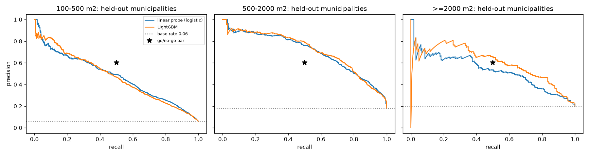
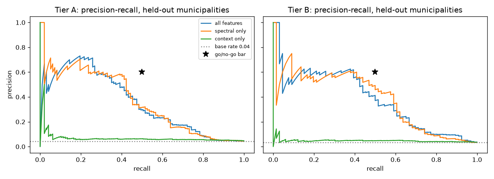
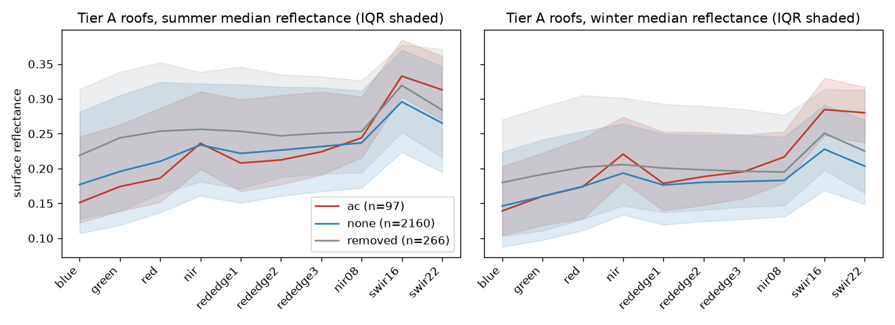
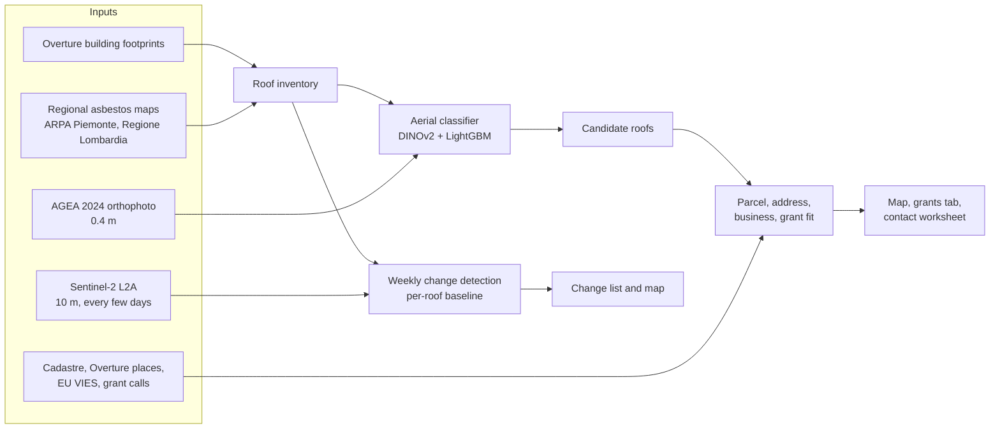
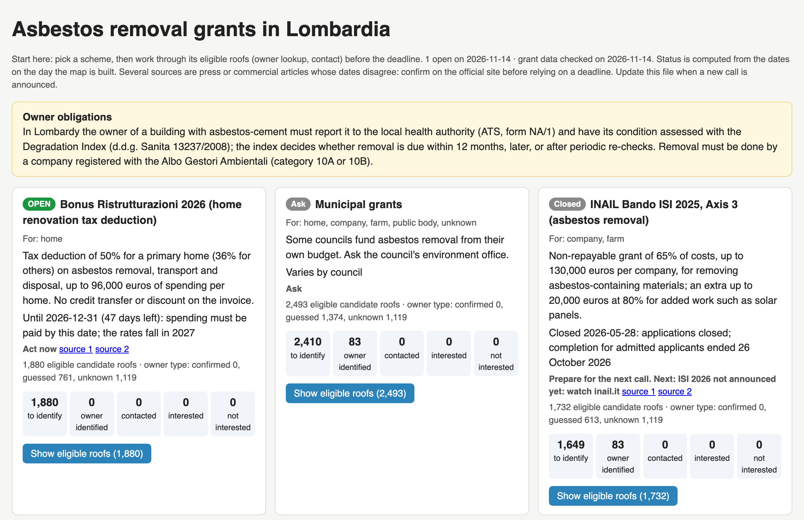

# Asbestos roof watch

Finds large roofs in northern Italy that are probably asbestos-cement ("eternit"), watches them for change, and links each one to the public information needed to get it removed: cadastral parcel, address, the business at the building and the grants that fit.

It uses free data only: Sentinel-2 satellite imagery, AGEA aerial orthophotos, the regional asbestos maps of Piedmont and Lombardy, Overture Maps and the Italian cadastre.

> **Prototype.** Built and measured on two pilot areas (Turin and Brescia) in November 2026. Every result is "suspected": only an inspection or a lab test confirms asbestos.



*Aerial classifier on held-out municipalities, Brescia pilot. The star is the pass mark set before the work started.*

## Why

Italy banned asbestos in 1992, but a great many asbestos-cement roofs are still in place on warehouses, factories and farm sheds. The official regional maps are years old, so nobody has a current list of which roofs are still there, which were replaced, and who to talk to about the rest. Grants for removal exist, but their windows are short.

## What it does

1. **Finds suspected roofs.** A classifier scores every building footprint from a 0.4 m aerial photo, trained on the official regional maps.
2. **Watches for change.** A weekly job reads new Sentinel-2 scenes and flags roofs whose spectrum departs from their own baseline: new metal roof, solar panels, demolition.
3. **Connects a roof to an owner.** Each candidate gets its cadastral parcel, nearest address, the businesses listed at the building and their public company record. It adds the removal grants that fit the likely owner type.

## Results

Full numbers, method and caveats are in [docs/RESULTS.md](docs/RESULTS.md). The pass mark, set in the plan before any code existed, was precision 0.6 at recall 0.5 on municipalities the model had never seen.

| Question | Pilot | Result |
|---|---|---|
| Can Sentinel-2 (10 m) identify asbestos roofs? | Turin, 19 municipalities, 5,097 roofs | **No.** Precision 0.30 at recall 0.5 on roofs of 2,000 m2 or more |
| Can free aerial photos (0.4 m)? | Brescia plain, 16 municipalities, 26,632 roofs | **Yes, for roofs of 500 m2 or more.** Precision 0.79 (500 to 2,000 m2) and 0.66 (2,000 m2 or more) at recall 0.5. Roofs of 100 to 500 m2 reach 0.47 and do not pass |
| Can Sentinel-2 see a roof being replaced? | Turin, archive from 2018 | **Partly.** It flags 27% of known remediations on large roofs, at 14 false alarms per 1,000 roofs per year. A remediated roof is about 6 times as likely to be flagged as one that stayed |
| Can aerial photos tell which roofs already have solar panels? | Lombardy, 302 municipalities | **Yes.** Average precision 0.85 to 0.92 |
| How many candidate roofs can be linked to a company from open data? | Brescia, 1,258 candidates | 96% get a cadastral parcel, 42% a company name. Owner names are not open data |

The Sentinel-2 result is a negative one, and it is reported as such. The satellite's 10 m pixels do not separate asbestos-cement from concrete and newer fibre-cement well enough:

| Sentinel-2 classifier, Turin | Sentinel-2 spectra, asbestos-cement against other roofs |
|---|---|
|  |  |

The measured accuracy of the aerial model is a lower bound, because the labels are from 2020 and some of those roofs have since been replaced. It was tested on one area only. Transfer to other areas and years is untested.

## How it works



- **Roof outlines** come from existing building footprints. They are not detected from imagery.
- **Sentinel-2** is read by window from cloud-optimised GeoTIFFs, so only the pixels inside each roof are fetched. Each roof is shrunk inward by 10 m, masked for cloud, and stored as one row per roof per date.
- **Change detection** divides each band by the median of all roofs in the same scene, which cancels haze and season. A change counts only when every clear observation departs in the same direction for at least 10 days.
- **Aerial detection** cuts one masked image chip per roof, embeds it with DINOv2 ViT-S/14 and scores it with LightGBM.
- **Evaluation** always splits by municipality, never at random. Neighbouring roofs look alike, and a random split would overstate accuracy.
- **The weekly run** is idempotent and resumable: running a date twice adds no rows and re-flags nothing.

## From a roof to a conversation

The map page has a Grants tab. Each scheme shows whether it is open, how many candidate roofs may be eligible, and how far along the contact work is. The list behind each card ranks roofs by size, asbestos score, owner-type certainty and solar fit.



How to use the map, the worksheet and the grant lists: [docs/CONTACTING.md](docs/CONTACTING.md).

## Privacy

Naming a building as "asbestos" can harm its owner, and an owner can be a private person. The project is built around that:

- **No building-level results are in this repository.** Data, model outputs, maps and worksheets stay on the machine that made them (`data/` and `outputs/` are git-ignored). The charts above are aggregates.
- **No phone numbers, emails or names of directors** are downloaded, stored or shown. Website URLs that carry a contact detail are cut back or dropped.
- **Sole traders are treated as people.** Their address is not stored and their record is marked as personal data.
- **An objection sticks.** A roof marked "do not contact" stays marked when files are rebuilt, the mark covers the whole parcel, and a business can be put on a suppression list that deletes what was stored about it.
- **Owner names are never collected in bulk.** They come from one cadastral lookup at a time, done by hand.
- **Crawling is polite.** The company step reads at most three pages per business website, obeys robots.txt and waits between requests.

[docs/CONTACTING.md](docs/CONTACTING.md) has the rules of thumb for contacting owners under Italian and EU law. It is practical guidance, not legal advice.

## Quick start

Requires Python 3.11 to 3.13. On macOS, LightGBM also needs `brew install libomp`.

```sh
python3.11 -m venv .venv
source .venv/bin/activate
pip install -e ".[dev]"
pytest -q          # 382 tests, no network or data needed
```

### Sentinel-2 pilot (Turin)

```sh
python scripts/fetch_labels.py                       # ARPA Piemonte labels -> data/raw/
# Overture buildings and GHSL tiles: see docs/DATA.md for the exact sources
python scripts/build_inventory.py                    # roofs, tiers, labels, pixel lookups
python scripts/context_features.py                   # building age and context
python scripts/extract_observations.py 2025-11-01 2026-11-13            # 12 months
python scripts/extract_observations.py 2017-01-01 2025-10-31 --max-cloud 30 --best-per-month \
    --out outputs/observations_archive.parquet       # archive for change validation
python scripts/train_eval.py                         # classifier, spectra, go/no-go numbers
python scripts/validate_change.py                    # change detection against known remediations
python run_weekly.py                                 # the weekly job
```

`run_weekly.py` monitors change on officially mapped roofs. `--with-detection` turns the Sentinel-2 classifier back on. `ops/install_schedule.sh` installs a launchd job that runs it on Mondays at 07:00 (macOS).

### Aerial pilot (Brescia)

```sh
pip install -e ".[aerial]"
python scripts/lombardy_build.py        # roofs and 2020 labels -> data/processed/lombardy_roofs.gpkg
python scripts/fetch_aerial_chips.py    # AGEA 2024 image chip per roof
python scripts/embed_chips.py           # DINOv2 embeddings
python scripts/train_aerial.py          # asbestos scores -> outputs/aerial_oof.parquet
python scripts/pv_dataset.py && python scripts/embed_chips.py --chips data/processed/pv_chips --out data/processed/pv_chip_embeddings.parquet
python scripts/train_pv.py && python scripts/score_pv_pilot.py          # solar-panel scores
python scripts/fetch_named_sites.py     # named farm and industrial sites (Overture)
python scripts/contact_worksheet.py     # parcel, address, businesses per roof -> worksheet and grant lists
python scripts/enrich_companies.py      # company public record per business website (about 40 min the first time, then cached)
python scripts/aerial_map.py            # outputs/aerial_map.html: map, roof panel and Grants tab
```

Open `outputs/aerial_map.html` from the `outputs/` folder on the machine that holds `data/processed/chips/`. `#roof=<id>` in the address opens one roof.

Some input downloads are not scripted yet (the Overture address and place extracts, and the AIA permit file). [docs/DATA.md](docs/DATA.md) lists them under "Known gap".

## Repository layout

| Path | Contents |
|---|---|
| `src/roofwatch/` | The package. Sentinel-2: `labels`, `footprints`, `inventory`, `extract`, `observe`, `store`, `features`, `model`, `change`, `weekly`, `pipeline`. Aerial and owners: `aerial`, `lombardy`, `cadastre`, `occupants`, `company`, `grants`, `panel`, `tabs`, `urls` |
| `scripts/` | One script per pipeline step |
| `run_weekly.py` | Weekly entry point |
| `tests/` | Unit tests with synthetic fixtures |
| `docs/` | Plan, data sources, results, contact guidance |
| `data/pilot_area.geojson` | The 19 Turin-belt municipalities of the Sentinel-2 pilot |
| `data/grants_lombardia.json` | Asbestos removal grants for Lombardy: who each is for, dates, sources |
| `ops/` | launchd job for the weekly run |
| `data/raw/`, `data/processed/`, `outputs/` | Inputs and results. Not committed |

## Documentation

| Document | What it covers |
|---|---|
| [docs/PLAN.md](docs/PLAN.md) | The original plan, written before any code: what is realistic, the method, the go/no-go gate, risks and tasks |
| [docs/DATA.md](docs/DATA.md) | Every data source: service, fields, licence, known gaps |
| [docs/RESULTS.md](docs/RESULTS.md) | Measured results for both pilots, the go/no-go decision, and what is not done |
| [docs/CONTACTING.md](docs/CONTACTING.md) | The grant-led workflow, the map panel, the worksheet and the rules for contacting owners |

## Data sources

| Data | Source | Licence |
|---|---|---|
| Satellite imagery | Copernicus Sentinel-2 L2A, through Element84 Earth Search | Free and open (Copernicus) |
| Aerial imagery | Ortofoto AGEA 2024 | CC BY 4.0 |
| Asbestos labels, Piedmont | ARPA Piemonte asbestos mapping | CC BY 4.0 |
| Asbestos labels, Lombardy | Regione Lombardia and ARPA Lombardia, "Mappatura delle coperture in cemento-amianto" | Not stated on the service. Check before reuse |
| Building footprints, addresses, places | Overture Maps (OpenStreetMap, Microsoft and others) | ODbL and CDLA Permissive 2.0 |
| Building age | GHSL built-up surface, European Commission JRC | CC BY 4.0 |
| Cadastral parcels | Agenzia delle Entrate, INSPIRE WFS | CC BY 4.0 |
| Company records | Each business's own website and the EU VIES service | Public |

None of this data is redistributed here. Details and exact endpoints are in [docs/DATA.md](docs/DATA.md).

## Status

- **Done:** both pilots, the weekly pipeline, the owner and company linkage, the map with its roof panel and Grants tab.
- **Not done:** the weekly schedule is not installed, so no unattended runs yet. The aerial model has not been run outside the Brescia pilot. Whole-region and multi-region runs are not started.
- **Known limits:** labels are years old, the largest-roof sample is small (163 positives), and the change detector misses most remediations.

## Disclaimer

A roof named by this project is suspected, not confirmed. The official maps are themselves remote sensing, and both the maps and the models can be wrong or out of date. Do not publish, share or act on building-level results as if they were findings. Nothing here is legal advice.
